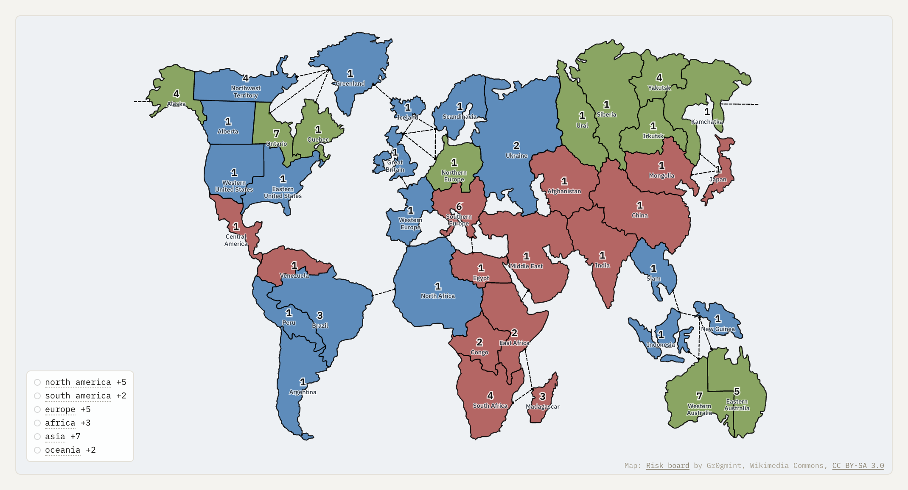

# RiskBench



_Map artwork: [Gr0gmint](https://commons.wikimedia.org/wiki/File:Risk_board.svg), [CC BY-SA 3.0](https://creativecommons.org/licenses/by-sa/3.0/)._

**Studying commitments and documented deception in LLM agents playing Risk.**

Agents pursue secret missions, negotiate, and make agreements that the game rules do not
enforce. RiskBench records messages, private decision memos, notes, and actions so those
agreements can be followed from negotiation to outcome.

- Run games and tournaments with configurable models, seating, and concurrency.
- Replay the board and conversations, inspect evidence, and compare evaluation versions.
- Evaluate commitments and documented deception during play or after a game finishes.

## Quick start

Requires [uv](https://docs.astral.sh/uv/getting-started/installation/) and Python 3.13+.

```bash
uv python install 3.13
uv sync
cp .env.example .env
uv run python -m risk_bench.main serve --port 8420
```

Open [localhost:8420](http://localhost:8420). Saved replays and random-player games need no
API keys. To run models, add the relevant provider keys to `.env` before launching a game.
See [setup and command-line usage](docs/usage.md) for details.

## Included tournament

The repository includes [12 completed games](data/v3/games/20261012-101836-seed8349) between
Claude Opus 5.5, Gemini 3.8 Flash, and GPT-6.1 Sol, with each of the six seating orders used
twice. Journals, model traces, evaluations, and replay history are included.

Automated annotations require substantive review; they are not a ranking of model honesty.
[Dataset details, research approach, and limitations](docs/research.md).

## Documentation

| Guide | Contents |
| --- | --- |
| [Usage](docs/usage.md) | Setup, CLI commands, tournament controls, evaluation reruns |
| [Research](docs/research.md) | Included dataset, annotation approach, findings, and limitations |
| [Annotation guidelines](docs/codebook-v4.md) | Commitment and documented-deception criteria |
| [Architecture](docs/architecture.md) | Game mechanics, private memos, and project structure |
| [Forking and resume](docs/forking.md) | Replay boundaries, saved state, and context edits |

RiskBench supports an ongoing master's thesis. The [report source](https://github.com/jacknurminen/risk-bench-thesis)
and [draft PDF](https://github.com/jacknurminen/risk-bench-thesis/blob/main/thesis/thesis.pdf)
are maintained in the separate thesis repository.
